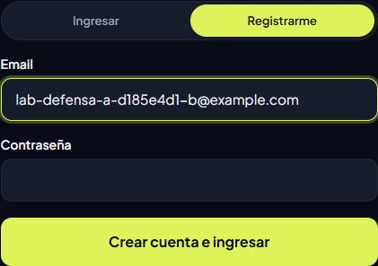

# Web II · TP3 

**Entrega en `TP3`.** API REST de listas y favoritos con Java 25, Spring Boot y PostgreSQL. **[Laboratorio público](https://web2-practica-front.nicotrib699.workers.dev/#/laboratorio)**. Vercel está seleccionado como API por defecto.

## Enlaces de despliegue

| Componente | Despliegues |
| --- | --- |
| API | [Cloudflare · Swagger](https://web2-practica-tp3.nicotrib699.workers.dev/swagger-ui/index.html) · [Vercel · Swagger](https://web2-practica-tp3.vercel.app/swagger-ui/index.html) |
| Front | [Cloudflare](https://web2-practica-front.nicotrib699.workers.dev/) · Vercel sin despliegue |
| Base de datos | [VPS · conexión por túnel privado](deployment/cloudflare/README.md#recorrido) · [Render · panel de PostgreSQL de respaldo](https://dashboard.render.com/d/dpg-dblq6st9el5s73ef0l4g-a) |

[Consigna oficial](https://unvime-web-2.matiendres.workers.dev/practicos/tp3/) · [Código del front publicado](https://github.com/Niquinhoo/Web2PracticaFront/tree/a41ce5759e4c551501c8eeec2f50a14455d19c84) · [Ejecutar la API en local](api-blank/README.md#ejecutar)

## 1. Dependencias y configuración

Spring Security protege las rutas y Nimbus firma y verifica JWT con HS256. JPA usa PostgreSQL y Flyway aplica las migraciones. Las credenciales de la base y `JWT_SECRETO` se inyectan por variables de entorno. Para las pruebas, Maven usa Surefire (`*Test`) y Failsafe (`*IT`), con PostgreSQL temporal en Testcontainers. [Dependencias y plugins](api-blank/pom.xml) · [Configuración de Spring](api-blank/src/main/resources/application.properties)

```properties
spring.jpa.hibernate.ddl-auto=validate
```

Flyway controla la evolución del esquema y Hibernate comprueba que las entidades coincidan con el resultado. [Configuración de Spring](api-blank/src/main/resources/application.properties)

## 2. Alta de usuario y validación

En **Registrarme**, el front manda `POST /api/auth/registro` con email y contraseña en JSON. `AuthController` valida la entrada con `@Valid`, `@Email` y restricciones de longitud. El servicio normaliza el email, verifica duplicados, guarda el hash BCrypt y asigna `USER`. El alta responde `201` con `id`, `email` y `rol`. Repetir el email devuelve `409` y la restricción `UNIQUE` también protege el dato ante registros simultáneos. [AuthForm](https://github.com/Niquinhoo/Web2PracticaFront/blob/a41ce5759e4c551501c8eeec2f50a14455d19c84/src/components/AuthForm.tsx#L44) · [AuthController](api-blank/src/main/java/ar/edu/unvime/apiblank/usuario/AuthController.java#L17) · [UsuarioServiceImpl](api-blank/src/main/java/ar/edu/unvime/apiblank/usuario/UsuarioServiceImpl.java#L20) · [V5](api-blank/src/main/resources/db/migration/V5__create_usuarios.sql)

```java
if (repository.buscarPorEmail(email).isPresent()) throw new ConflictoException("El email ya está registrado");
return repository.crear(email, encoder.encode(password), Rol.USER);
```



## 3. Login, JWT y rutas públicas

Después del alta, el mismo formulario manda `POST /api/auth/login`. El backend compara la contraseña con el hash mediante `encoder.matches` y devuelve `200` con un JWT firmado que incluye `sub` (id), `rol` y vencimiento. Una contraseña incorrecta devuelve `401`. React conserva el JWT en memoria y lo adjunta como `Authorization: Bearer <JWT>` solo si el caso le pasa una identidad. [UsuarioServiceImpl](api-blank/src/main/java/ar/edu/unvime/apiblank/usuario/UsuarioServiceImpl.java#L26) · [JwtService](api-blank/src/main/java/ar/edu/unvime/apiblank/seguridad/JwtService.java#L17) · [Cliente HTTP](https://github.com/Niquinhoo/Web2PracticaFront/blob/a41ce5759e4c551501c8eeec2f50a14455d19c84/src/lib/api.ts#L84)

```java
.requestMatchers("/api/auth/**", "/api/productos/**").permitAll()
.requestMatchers(HttpMethod.GET, "/health", "/ping", "/swagger-ui.html", "/swagger-ui/**", "/v3/api-docs/**", "/v3/api-docs.yaml").permitAll()
.anyRequest().authenticated())
```

`NimbusJwtDecoder` verifica la firma HS256, el emisor, la vigencia y los claims de identidad. El JWT alterado conserva la firma de A y cambia su payload a `rol: "ADMIN"`. Spring Security lo rechaza con `401` antes del controlador, igual que una solicitud sin token a una ruta protegida. El navegador puede pedir permiso de CORS con `OPTIONS` antes del `GET` con Bearer. CORS permite enviar la petición desde el origen autorizado y Spring valida el JWT en el `GET`. [SecurityConfig](api-blank/src/main/java/ar/edu/unvime/apiblank/seguridad/SecurityConfig.java#L33) · [Código que modifica el JWT](https://github.com/Niquinhoo/Web2PracticaFront/blob/a41ce5759e4c551501c8eeec2f50a14455d19c84/src/lib/jwt.ts#L27)

[Captura de altas, ingresos y rechazos en el Laboratorio](api-blank/docs/tp3/evidencias/front-publico-2026-11-06/02-autenticacion.png)

## 4. Autorización por dueño y rol

V6 agrega `listas.usuario_id` como FK a `usuarios`. Al crear la lista, `ListaServiceImpl` toma el dueño de la identidad autenticada con `seguridad.usuarioId()`. Al consultar, busca la lista y llama a `exigirPropiedad` con el dueño guardado en PostgreSQL. Esta regla vive en el servicio porque también se aplica al borrar, leer favoritos y moverlos. El movimiento valida **origen y destino** antes de escribir en una transacción. `GET /api/listas` filtra por dueño para `USER` y devuelve todas para `ADMIN`. [V6](api-blank/src/main/resources/db/migration/V6__add_usuario_id_a_listas.sql) · [ListaServiceImpl](api-blank/src/main/java/ar/edu/unvime/apiblank/lista/ListaServiceImpl.java#L25)

```java
public void exigirPropiedad(Long usuarioId) {
    if (!esAdmin() && !Objects.equals(usuarioId(), usuarioId))
        throw new AccessDeniedException("El recurso pertenece a otro usuario");
}
```

`ApiExceptionHandler` traduce la excepción a `403`. Con un JWT auténtico de `ADMIN` se cumple la excepción de rol y el controlador devuelve `200` con la lista. Para la demo se dio de alta una tercera cuenta como `USER`, se la promovió desde PostgreSQL y se inició sesión de nuevo para obtener el token firmado con el rol nuevo. [ContextoSeguridad](api-blank/src/main/java/ar/edu/unvime/apiblank/seguridad/ContextoSeguridad.java#L16) · [ApiExceptionHandler](api-blank/src/main/java/ar/edu/unvime/apiblank/error/ApiExceptionHandler.java#L28)

### Recorrido real del front contra Vercel

Captura del **6 de noviembre de 2026**. Chrome abrió la URL pública del front en una sesión limpia y Vercel ya estaba seleccionado. A tenía `sub=25`. B era el dueño de la lista `21` (`usuarioId=26`). El ADMIN legítimo tenía `sub=27`. Los `GET` salieron con `Accept: application/json` y sin cuerpo.

| Caso | Petición y credencial | Respuesta de Spring |
| --- | --- | --- |
| Alta y login | `POST /api/auth/registro` y `POST /api/auth/login`, con email y contraseña | `201` con `rol=USER`, luego `200` con JWT |
| Login con contraseña incorrecta | `POST /api/auth/login` | `401` · `Credenciales inválidas` |
| Lista propia | `GET /api/listas/20` con Bearer de A | `200` · dueño `25` |
| Lista ajena | `GET /api/listas/21` con el mismo Bearer de A | `403` · `Acceso denegado` |
| Sin token | `GET /api/listas` sin `Authorization` | `401` · `Se requiere un token válido` |
| JWT manipulado | `GET /api/listas` con payload `sub=25, rol=ADMIN` y firma original de A | `401` · `Se requiere un token válido` y `WWW-Authenticate: Bearer` |
| ADMIN sobre la misma lista ajena | `GET /api/listas/21` con JWT válido de `sub=27, rol=ADMIN` | `200` · `{"id":21,"nombre":"Lab · lista ajena","usuarioId":26}` |

**Ejecutar consigna** corrió también `/health` y el catálogo públicos, favoritos sin token, email duplicado, listado de `USER`, consulta y borrado ajenos, movimiento en las dos direcciones, dueño forzado en el body y listado de `ADMIN`. **Comprobaciones extra** permite ejecutar el JWT manipulado de forma individual. La limpieza devolvió `204` para los recursos creados y se retiraron el rol temporal y las tres cuentas de esta corrida. [Traza HTTP con secretos ocultos](api-blank/docs/tp3/evidencias/front-publico-2026-11-06/traza-http.json) · [Captura del ADMIN](api-blank/docs/tp3/evidencias/front-publico-2026-11-06/03-admin.png) · [Captura del JWT alterado](api-blank/docs/tp3/evidencias/front-publico-2026-11-06/04-jwt-manipulado.png)

## 5. Pruebas

Las unitarias prueban que la lista queda asociada al usuario autenticado y que se persiste el hash. Las integraciones prueban registro, login, firma, propiedad y rol sobre PostgreSQL de Testcontainers con Flyway. Por ejemplo, esta verificación exige que la creación use el usuario de la identidad. [ListaServiceImplTest](api-blank/src/test/java/ar/edu/unvime/apiblank/lista/ListaServiceImplTest.java#L16) · [UsuarioServiceImplTest](api-blank/src/test/java/ar/edu/unvime/apiblank/usuario/UsuarioServiceImplTest.java) · [SeguridadIT](api-blank/src/test/java/ar/edu/unvime/apiblank/seguridad/SeguridadIT.java#L92)

```java
verify(listas).crear("Regalos", 10L);
```

## 6. CI/CD con GitHub Actions

| Repositorio | Qué ejecuta Actions | Cómo se publica |
| --- | --- | --- |
| API | Cada push o PR inicia dos jobs. Java 25 ejecuta Maven con unitarias, integraciones y Flyway sobre el PostgreSQL temporal de Testcontainers. El job guarda los XML de Surefire/Failsafe como artefacto, incluso si falla. El segundo job valida y prueba el Worker. | Vercel gestiona las publicaciones de la API desde `TP3` mediante su integración Git. El workflow Java entrega el resultado de validación. [Workflow de la API](.github/workflows/ci.yml) · [Guía de Vercel](deployment/vercel/README.md) |
| Front | `validate` usa Node de `.nvmrc`, instala con `npm ci` y corre lint, pruebas, build y `wrangler deploy --dry-run`. | El job `deploy` requiere `validate` en verde, un push a `main` y la configuración de Cloudflare. Tras publicar correría `npm run smoke`. Para la defensa se publicó manualmente el commit validado de `TP3` con Wrangler, porque ese job quedó omitido. [Workflow del front](https://github.com/Niquinhoo/Web2PracticaFront/blob/a41ce5759e4c551501c8eeec2f50a14455d19c84/.github/workflows/ci.yml) |

Este es el paso que reúne las comprobaciones de la API en un solo comando reproducible.

```yaml
- name: Run unit and integration tests with Testcontainers
  run: ./mvnw --batch-mode verify
```

Para explicar el pipeline en la defensa, abrí **Actions → Java CI → test-api-blank**. Mostrá el paso de Maven y el artefacto `test-reports`. El TP conserva la corrida roja al esperar `ADMIN` en el registro y la recuperación al volver a esperar `USER`. En el front, la corrida muestra `validate` exitoso y `deploy` omitido. [CI de la API](https://github.com/Niquinhoo/Web2Practica/actions/runs/42164560751) · [Fallo deliberado](https://github.com/Niquinhoo/Web2Practica/actions/runs/40817485164) · [Recuperación](https://github.com/Niquinhoo/Web2Practica/actions/runs/40817598752) · [CI del build publicado](https://github.com/Niquinhoo/Web2PracticaFront/actions/runs/42164198656) · [Referencia de GitHub Actions](https://docs.github.com/en/actions/reference/workflows-and-actions/workflow-syntax)


## 7. Despliegue y bases

**Por qué Vercel para la defensa.** Container Runtime en Hobby aloja el contenedor Java del TP3. En dos rondas desde la misma máquina, la primera llamada a `GET /health` fue más rápida en Vercel. Tras cada primera respuesta hicimos tres solicitudes consecutivas. Los logs de Vercel muestran el arranque de Spring en ambas rondas. En Cloudflare la diferencia con las muestras siguientes es compatible con un arranque en frío y coincide con el comportamiento documentado previamente. La comparación mide lo que espera quien abre el front, incluidos red y arranque.

| API | Primera respuesta · ronda 1 | Primera respuesta · ronda 2 | Tres siguientes por ronda |
| --- | ---: | ---: | ---: |
| Vercel | 15,14 s | 9,80 s | 0,24–0,33 s |
| Cloudflare | 49,80 s | 50,62 s | 0,25–0,27 s |

`/health` confirma que la API responde. Las operaciones de listas y la consulta de `flyway_schema_history` acreditan acceso a PostgreSQL. La pantalla **Proveedores** consulta `/health` al abrirse, así que su primera muestra puede corresponder a una API activa. [Muestras y logs resumidos](api-blank/docs/tp3/evidencias/laboratorio-2026-11-06/arranque.json) · [API Vercel](https://web2-practica-tp3.vercel.app/health) · [API Cloudflare](https://web2-practica-tp3.nicotrib699.workers.dev/health) · [Historial de Cloudflare](deployment/cloudflare/README.md#arranque-en-frío)

**Principal, en el servidor remoto (VPS).** PostgreSQL vive fuera de los contenedores y conserva los datos al reiniciar la API. El recorrido es `Spring/JDBC → listener cloudflared → puente autenticado → Cloudflare Tunnel/VPC → PostgreSQL`. Así se reutiliza el servidor y se mantiene el puerto de PostgreSQL fuera de Internet. Durante la demo se verificaron las seis migraciones y la cuenta de Vercel en esa base. Cuando ambos despliegues se conectan a la principal, pueden leer los mismos datos. Cada API emite sus propios JWT. [Conexión principal](deployment/cloudflare/README.md) · [Despliegue de Vercel](deployment/vercel/README.md)

**Respaldo, en Render.** Si se configura `DATABASE_FALLBACK_URL` y la principal falla al abrir el pool, el backend puede arrancar con PostgreSQL administrado en Render por TLS. Flyway y JPA usan la base seleccionada durante toda la vida de esa instancia. Así la práctica puede arrancar aunque el túnel esté caído. La base de Render tiene datos e IDs propios, sin replicación. Cambiar de base requiere reiniciar la instancia y volver a iniciar sesión para la demo. El plan gratuito vence a los 30 días. Esta corrida usó la principal y no forzó un fallo del túnel. [DataSourceFailoverConfig](api-blank/src/main/java/ar/edu/unvime/apiblank/config/DataSourceFailoverConfig.java#L23) · [Documentación de Render](https://render.com/docs/free#free-postgres)

```java
var principal = crear(url, usuario, password, segundos, minimoInactivas);
```

Si esa apertura falla, el `catch` retorna `crear(respaldoUrl, respaldoUsuario, respaldoPassword, Math.max(segundos, 15), minimoInactivas)`. Los valores de conexión se guardan en el entorno de cada despliegue. [Selección de la base](api-blank/src/main/java/ar/edu/unvime/apiblank/config/DataSourceFailoverConfig.java#L33)

### Cambios de infraestructura trabajados con Claude

| Decisión | Justificación y evidencia |
| --- | --- |
| Comprobar disponibilidad del contenedor al arrancar o recuperarse | El Worker reutiliza el estado de disponibilidad y evita un `/health` interno en cada petición. Vuelve a comprobarlo si el contenedor se detiene o falla el reenvío. [Commit `6251c85`](https://github.com/Niquinhoo/Web2Practica/commit/6251c85) |
| Limitar el JIT a C1 en Cloudflare | `-XX:TieredStopAtLevel=1` reduce el trabajo de compilación de la JVM al arrancar con poca CPU. En el banco local bajó de 88 s a 48 s hasta `/health`. [Commit `35b7d1f`](https://github.com/Niquinhoo/Web2Practica/commit/35b7d1f) |
| Generar AOT Cache en la imagen | El build de Java 25 prepara clases de Spring sin conectarse a PostgreSQL. Con AOT y C1 el banco local llegó a 22 s. El archivo agrega unos 130 MB a la imagen. [Commit `cf84e46`](https://github.com/Niquinhoo/Web2Practica/commit/cf84e46) |
| Iniciar Hikari con una conexión ociosa | En producción, `minimum-idle=1` reduce el trabajo inicial del pool a través del túnel y permite crecer a demanda. En el banco local las consultas bajaron de 61 a 53. Se conservaron Flyway y `ddl-auto=validate`. [Commit `aecca42`](https://github.com/Niquinhoo/Web2Practica/commit/aecca42) |
| Configurar respaldo y CORS explícitos | Render permite iniciar si la base principal no responde. CORS permite al origen del front leer respuestas de la API, incluidos `401` y `403`. [Fallback `89b7124`](https://github.com/Niquinhoo/Web2Practica/commit/89b7124) · [CORS `4d98a4d`](https://github.com/Niquinhoo/Web2Practica/commit/4d98a4d) |
| Mostrar que la API está despertando | Tras cuatro segundos el login muestra el aviso de arranque. Es un cambio de interfaz. [Commit del front `9795c76`](https://github.com/Niquinhoo/Web2PracticaFront/commit/9795c76) |

Los commits registran la coautoría y el motivo de cada ajuste. El banco local usó 0,5 CPU, 1 GB y una base ya migrada. Sus tiempos sirven para comparar variantes. Los tiempos públicos están en la tabla anterior. [Registro de las mediciones y alternativa descartada](https://github.com/Niquinhoo/Web2Practica/commit/2c1fd01)


## 8. Swagger y Guia probar la tool

1. Abrí el [front público](https://web2-practica-front.nicotrib699.workers.dev/#/laboratorio) y elegí **Registrarme**. Mostrá `201` y el login `200` en **Laboratorio → Autenticación**. Abrí los cuerpos en **Registro de peticiones** para mostrar que la contraseña y el token están ocultos.
2. Prepará el escenario. Mostrá `200` para la propia, `403` para la ajena y `401` sin token. Repetí la consulta ajena con un ADMIN firmado y compará con el JWT alterado.
3. Abrí [Swagger en Vercel](https://web2-practica-tp3.vercel.app/swagger-ui/index.html). OpenAPI declara `bearerAuth` para listas y favoritos. Mostrá `/health` y el CI. Cerrá con los tiempos de la primera petición y el papel de cada base.

[README de la API](api-blank/README.md) · [Evidencia histórica y de CI](api-blank/docs/EVIDENCIA-TP3.md)

[Versión pública del front y commit de origen](api-blank/docs/tp3/evidencias/front-publico-2026-11-06/despliegue.json) · [Teoría](TP3-teoria.md) · [Plan de trabajo](TP3-paso-a-paso.md)
